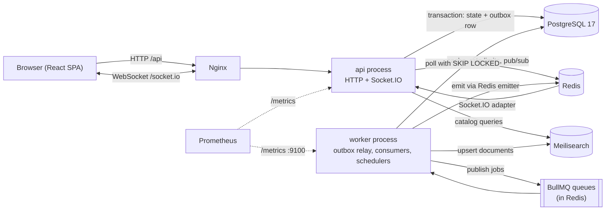
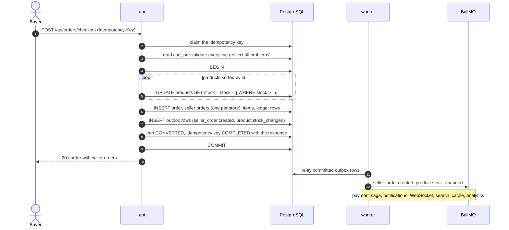
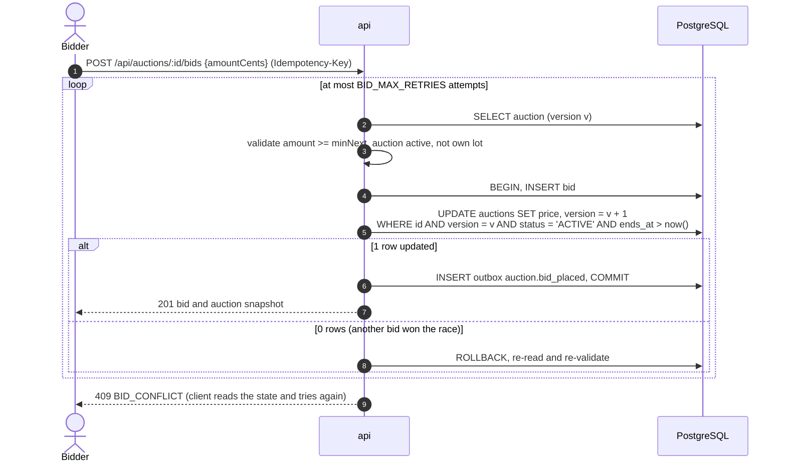
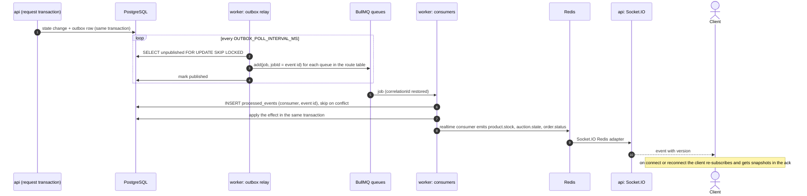

# Multi-Vendor Marketplace

A marketplace where independent sellers list fixed-price products and time-limited auctions, and a
buyer pays for products of several sellers in one checkout. The order splits into one seller order
per store, each with its own status, commission and payout. Stock, bids and order statuses update
in real time.

- **Backend:** NestJS modular monolith (TypeScript), PostgreSQL 17 with Prisma, Redis + BullMQ,
  Meilisearch, Socket.IO.
- **Frontend:** React + Vite, TanStack Query, Tailwind, Storybook.
- **Delivery guarantees:** transactional outbox, idempotent consumers, `Idempotency-Key` on every
  money-relevant request, saga with compensation for payments.
- **Everything runs with one command:** `docker compose up --build`.

## Contents

1. [Architecture](#architecture)
2. [Technology choices](#technology-choices)
3. [Consistency model](#consistency-model)
4. [Saga and compensation](#saga-and-compensation)
5. [Idempotency](#idempotency)
6. [Edge cases](#edge-cases)
7. [Security](#security)
8. [Observability](#observability)
9. [Caching](#caching)
10. [Running the project](#running-the-project)
11. [Demo walkthrough](#demo-walkthrough)
12. [Development and tests](#development-and-tests)
13. [Load test results](#load-test-results)
14. [Assumptions](#assumptions)
15. [Known limitations and what I would do differently](#known-limitations-and-what-i-would-do-differently)

## Architecture

### Components

One code base produces two processes. The **api** process serves HTTP and WebSocket traffic. The
**worker** process relays outbox events, runs the queue consumers and the scheduled jobs. They share
nothing but PostgreSQL and Redis, so each scales on its own.



Rule of the design: **an HTTP request never talks to the queue, the search index or a WebSocket
directly.** It writes its state change and an outbox row in one database transaction. Everything
asynchronous follows from the committed outbox row.

### Module boundaries

The backend is a modular monolith. Each business module is a self-contained Nest feature module
(`apps/api/src/modules/<name>`): controller → service → repository, DTOs, queue processors and
pure domain logic.

| Module            | Responsibility                                                             |
| ----------------- | -------------------------------------------------------------------------- |
| `auth`            | Registration, login, JWT access and rotating refresh tokens, Google OAuth2 |
| `users`           | Profiles and roles                                                         |
| `sellers`         | Seller applications and their moderation, store profiles                   |
| `categories`      | Category tree, managed by admins                                           |
| `products`        | Seller catalog, moderation, stock, soft delete, product page cache         |
| `search-sync`     | Meilisearch index, catalog queries, SQL fallback                           |
| `cart`            | Multi-vendor cart, auction lots for winners                                |
| `orders`          | Checkout split, seller order state machine, cancellation, refunds, saga    |
| `bidding`         | Auctions, bids, optimistic locking, auction lifecycle                      |
| `payments-ledger` | Mock payments, commission ledger, payouts, seller finance                  |
| `reviews`         | Verified-purchase reviews and ratings                                      |
| `disputes`        | Buyer–seller disputes and their resolution                                 |
| `analytics`       | Read models, dashboards, CSV and JSON export                               |
| `notifications`   | Notifications, WebSocket gateway and the event-to-WebSocket projection     |

Technical modules (`prisma`, `redis`, `queue`, `outbox`, `idempotency`, `cache`, `search`,
`logger`, `metrics`, `health`, `common`, `config`) sit beside them and never import a business
module.

The boundaries are enforced, not just agreed on:

- A module reaches another one only through the providers that module exports. ESLint
  (`import-x/no-restricted-paths`) forbids importing another module's repositories and queue
  processors.
- Fixed dependency directions: `orders → payments-ledger`, `products → bidding`. The reverse
  direction exists only as domain events (`payments-ledger` learns about seller orders from event
  payloads and never reads the orders tables).
- `import-x/no-cycle` forbids circular imports.
- Files with pure domain logic (state machines, commission, bid validation, order status
  aggregation, cart splitting) may not import Nest, Prisma, BullMQ, Redis, Meilisearch or
  Socket.IO. The queue or the search engine can be replaced without touching business rules; they
  sit behind `SearchPort`, `PaymentGatewayPort`, `RealtimePublisherPort` and the outbox.
- Each repository touches only the tables of its module.

The database schema and its constraints are documented in [`docs/DATABASE.md`](docs/DATABASE.md),
the REST API in [`docs/api/openapi.json`](docs/api/openapi.json) (also served as Swagger UI at
`/api/docs`).

### Checkout

One transaction decrements the stock of every store's products, creates the order and one seller
order per store, writes the ledger and the outbox rows. A single unavailable line rolls back the
whole checkout.



If a line cannot be fulfilled the buyer gets `409 CART_ITEMS_UNAVAILABLE` (pre-check, lists every
problem) or `409 INSUFFICIENT_STOCK` (lost the race on the conditional update); nothing is
changed.

### Bidding

Bids use optimistic locking on the auction row. The deadline is compared with the database clock
(`now()` in SQL), never the application's.



Closing an auction is a conditional update of the same row (`WHERE status = 'ACTIVE' AND ends_at <=
now()`). Both statements lock that row, so a bid in the last millisecond either lands before the
close and counts, or is rejected. An accepted bid after the close is impossible.

### Outbox to consumers to WebSocket



Delivery is at-least-once: a crash between publishing and marking the row publishes twice. BullMQ
drops the duplicate by `jobId`, and each consumer's inbox row (`processed_events`) drops it
again.

## Technology choices

| Concern        | Choice                                 | Why                                                                                                                                                                                                                                                                                                                                                              |
| -------------- | -------------------------------------- | ---------------------------------------------------------------------------------------------------------------------------------------------------------------------------------------------------------------------------------------------------------------------------------------------------------------------------------------------------------------- |
| Backend shape  | NestJS modular monolith, two processes | A checkout over many stores must be one database transaction. Split into services, even the stock decrement would need two-phase commit or a saga. Module boundaries are enforced by Nest exports and ESLint, so a module can still be extracted later. A separate `worker` process isolates background load from HTTP and scales independently.                 |
| Database       | PostgreSQL 17                          | Required, and used for what it is good at: transactions, row locks, `CHECK` constraints (`stock >= 0`), partial indexes, `FOR UPDATE SKIP LOCKED` for the outbox relay, `pg_trgm` for the degraded catalog search.                                                                                                                                               |
| ORM            | Prisma                                 | Types generated from one schema, declarative migrations whose SQL is readable, interactive transactions with an isolation level. Gaps (no `SELECT … FOR UPDATE`, no `now()` in conditions) are filled with `$queryRaw` tagged templates; `$queryRawUnsafe` is forbidden by ESLint. Compared with TypeORM: less decorator magic at runtime and more stable types. |
| Transactions   | `nestjs-cls` + transactional adapter   | A service opens a transaction; repositories of other modules (`orders → products → payments-ledger → outbox`) join it without passing a client around.                                                                                                                                                                                                           |
| Search         | Meilisearch                            | Facets and `facetStats` (price range) out of the box, typo tolerance, one small container (Elasticsearch needs 1–2 GB of RAM). Behind `SearchPort`, so swapping to Elasticsearch does not touch the domain.                                                                                                                                                      |
| Queue          | Redis + BullMQ                         | Redis is already needed for the cache, rate limiting and the Socket.IO adapter, so there is one infrastructure dependency instead of two (RabbitMQ). BullMQ gives retries with backoff, delayed jobs (auction deadlines), repeatable jobs, deduplication by `jobId` and a failed set that serves as a dead-letter queue.                                         |
| Event delivery | Transactional outbox + inbox           | The event is written in the same transaction as the state it describes, so "event sent but transaction rolled back" and its reverse cannot happen. The inbox makes at-least-once delivery harmless.                                                                                                                                                              |
| Real-time      | Socket.IO, Redis adapter and emitter   | Rooms, automatic reconnect, acknowledgement callbacks (used to return snapshots on subscribe), horizontal scaling. The worker emits through the Redis emitter, so it needs no WebSocket server.                                                                                                                                                                  |
| Auth           | Passport, JWT, argon2id                | Access token 15 minutes, kept in memory by the SPA. Refresh token is opaque, stored hashed, delivered in an httpOnly cookie, rotated on every use; reuse of a rotated token revokes the whole session family.                                                                                                                                                    |
| Rate limiting  | `@nestjs/throttler` with Redis storage | Limits are shared by every api instance; separate named limits for login, registration, refresh and bids.                                                                                                                                                                                                                                                        |
| Frontend       | React, Vite, TanStack Query, Tailwind  | Query invalidation makes the WebSocket resync trivial; optimistic updates with rollback for the cart; Recharts for the sales chart; Storybook for the components.                                                                                                                                                                                                |
| Observability  | `nestjs-pino`, `prom-client`           | JSON logs with a correlation id from request to WebSocket; Prometheus metrics from both processes.                                                                                                                                                                                                                                                               |

## Consistency model

| Operation or data                                                       | Consistency                   | Mechanism                                                    | Why                                                                           |
| ----------------------------------------------------------------------- | ----------------------------- | ------------------------------------------------------------ | ----------------------------------------------------------------------------- |
| Checkout: stock of all stores, order, seller orders, commission, ledger | **Strong**                    | One transaction, conditional `UPDATE`s, `CHECK (stock >= 0)` | Money and stock; the specification asks for one transaction for all the stock |
| Placing a bid                                                           | **Strong**                    | Optimistic lock on `version`, database clock                 | No lost update, exactly one leader                                            |
| Closing an auction, winner window, new round                            | **Strong** on the auction row | Conditional, idempotent `UPDATE`s                            | Races with last-second bids and with the winner's checkout                    |
| Seller order status and the order's aggregate status                    | **Strong**                    | Transaction with `FOR UPDATE` on the parent order            | Two stores changing their parts concurrently cannot overwrite the aggregate   |
| Cancellation, partial refund (stock, ledger, commission recalculation)  | **Strong**                    | One transaction                                              | Financially significant                                                       |
| Payment of a seller order and its compensation                          | **Eventual** (saga)           | Outbox → `payments` → `payment.failed` → compensation        | A payment provider cannot be part of a database transaction                   |
| Search index                                                            | **Eventual**                  | Outbox → `search-sync`, state-based                          | Required: the index is updated asynchronously, never by a dual write          |
| Cache                                                                   | **Eventual**, short bound     | `DEL` after commit + `DEL` from a consumer + TTL             | Staleness is limited to the time between commit and invalidation              |
| WebSocket updates                                                       | **Eventual** plus resync      | Outbox → worker → Redis emitter; snapshots on reconnect      | A pushed message can be lost; the client can always fetch the current state   |
| Notifications, analytics read models, payouts                           | **Eventual**                  | Outbox → consumers with an inbox                             | They never decide an invariant                                                |

The rule of thumb: whatever protects money or stock is decided inside one transaction on one
database; whatever merely reflects that state elsewhere is derived from committed outbox events.

## Saga and compensation

Payment is mocked, but handled as a real asynchronous step, **per seller order**. A failure of one
store's payment never touches the other stores' parts of the same order.

```text
checkout transaction ─► seller_order.created ─► [payments] mock capture
                                                   ├─ success ─► payment.captured ─► [orders-saga] paymentStatus = CAPTURED
                                                   └─ declined ─► payment.failed   ─► [orders-saga] paymentStatus = FAILED
                                                                                      + compensation: cancel this seller order
seller_order.status_changed (COMPLETED) ─► [payouts] payout (mock) + ledger PAYOUT
```

Compensation of a declined payment is the same operation as any seller order cancellation, run by
the system actor with the reason `PAYMENT_FAILED`, in one transaction:

1. lock the parent order and verify the transition;
2. return the stock of that seller order's items (an auction lot starts a new round);
3. write `CANCELLATION` and `COMMISSION_REVERSAL` ledger rows; commission and payout become 0;
4. recompute the order's totals and aggregate status (`hasCancelledParts` is set);
5. record outbox events (`seller_order.cancelled`, `product.stock_changed`, …).

The other seller orders are untouched, which an e2e test asserts. Technical failures (Redis or
database down) are not business outcomes: the job is retried with exponential backoff and, once the
attempts are exhausted, stays in the failed set (the dead-letter queue, `queue_dead_letter_total`).
A race where a payment is captured for a seller order that was cancelled in the meantime is
resolved by marking it `REFUNDED`, since its finances were already reversed on cancellation.
`MOCK_PAYMENT_FAILURE_RATE` lets you watch the compensation happen.

## Idempotency

Three layers, for three kinds of repetition:

- **Client retries.** Checkout, bids, refunds and dispute resolution require an `Idempotency-Key`
  header (UUID). The request hash is stored with the key; a retry with the same body replays the
  stored response (`Idempotent-Replayed: true`), the same key with a different body is
  `422 IDEMPOTENCY_KEY_REUSED`, a request still in progress is `409`. The result is stored in the
  same transaction as the business effect, so a crash cannot leave an effect without its key. A
  failed request releases the key, so transient errors (`BID_CONFLICT`, `INSUFFICIENT_STOCK`) are
  not remembered.
- **Duplicate events.** The outbox relay may publish twice. BullMQ rejects a second job with the
  same `jobId`; each consumer additionally inserts `(consumer, event id)` into `processed_events`
  in the same transaction as its effect and skips on conflict. Effects outside the database
  (Meilisearch, cache, WebSocket) are naturally idempotent: the index document is re-read from the
  database and upserted, `DEL` can repeat, WebSocket events carry a `version` the client compares.
- **Conditional state changes.** Auction close, winner expiry and saga steps are `UPDATE … WHERE
status = …` statements; running them twice changes nothing the second time.

Tested by redelivering the same event to each consumer and asserting a single effect.

## Edge cases

| Case from the specification                         | How it is handled                                                                                                                                                                                                                                                                                                                                                                                                                       |
| --------------------------------------------------- | --------------------------------------------------------------------------------------------------------------------------------------------------------------------------------------------------------------------------------------------------------------------------------------------------------------------------------------------------------------------------------------------------------------------------------------- |
| Concurrent bids in the last second of an auction    | Bid and close are conditional updates of the same row; the row lock orders them. The deadline is the database's `now()`. Bids landing before the close count, later ones are `AUCTION_ENDED`. Load-tested with 200 concurrent bidders (see below).                                                                                                                                                                                      |
| Seller deletes a product that is in somebody's cart | Delete is a soft delete (`archivedAt`). The cart line turns `UNAVAILABLE`; checkout answers `409 CART_ITEMS_UNAVAILABLE` listing every affected line. An auction with bids or a pending winner cannot be archived (`409 PRODUCT_HAS_ACTIVE_AUCTION`).                                                                                                                                                                                   |
| Partial cancellation of a multi-vendor order        | A seller order is cancelled alone: stock returns, commission is reversed, the order's totals and aggregate status are recomputed (`PARTIALLY_SHIPPED`, `hasCancelledParts`), the other seller orders keep going.                                                                                                                                                                                                                        |
| The same event delivered twice                      | Relay publishes with `jobId = event id`, every consumer has an inbox row in the effect's transaction (see [Idempotency](#idempotency)).                                                                                                                                                                                                                                                                                                 |
| WebSocket connection lost during a live auction     | Socket.IO reconnects by itself. On every connect the client re-subscribes to its channels and receives the current snapshot in the acknowledgement, invalidates its order queries and fetches missed notifications (`GET /api/notifications?after=`). Events apply only if their `version` is newer; the countdown uses `serverTime` from the snapshot. A bid is a REST call with an idempotency key, so retrying after a drop is safe. |
| The auction winner does not check out in time       | A delayed job plus a periodic sweeper (in case a timer is lost) start a new round of the same auction after the checkout window; the winner's cart line becomes unavailable. The expiry and the winner's checkout are conditional updates of one row, so exactly one wins.                                                                                                                                                              |
| Search index unavailable                            | The catalog falls back to PostgreSQL (`degraded: true`, header `X-Search-Degraded`, no facets or typo tolerance). Failed index updates are re-driven by the worker once Meilisearch is back.                                                                                                                                                                                                                                            |
| Redis unavailable                                   | The cache fails open and reads from the database; the outbox keeps events pending and the relay backs off, so nothing is lost.                                                                                                                                                                                                                                                                                                          |
| Stock changes between "add to cart" and checkout    | Checkout pre-validates every line and then decrements with `WHERE stock >= q`; the atomic update is the final authority.                                                                                                                                                                                                                                                                                                                |
| Two buyers race for the last unit                   | Exactly one conditional decrement succeeds; the other gets `409 INSUFFICIENT_STOCK` and nothing changes. Load-tested: 500 buyers, 100 units, exactly 100 orders.                                                                                                                                                                                                                                                                        |

## Security

**Authentication.** Passwords are hashed with argon2id. The access JWT lives 15 minutes and is held
in memory only. The refresh token is a random 256-bit value, stored only as a hash, sent as an
httpOnly `SameSite=Lax` cookie scoped to `/api/auth`, rotated on every use; presenting an already
rotated token revokes the whole family. The refresh endpoint also requires an `X-Requested-With`
header as a CSRF guard. A wrong email and a wrong password produce the same answer. Signing in
with Google links to an existing account with the same verified email and keeps password login
working.

**Authorization and IDOR.** Roles are checked by guards (`CUSTOMER`, `SELLER`, `ADMIN`; seller
endpoints also require an approved store). Ownership is checked in the service or repository with the
owner in the `WHERE` clause. A resource that belongs to somebody else is answered with **404**, not
403, so its existence is not revealed. The matrix below is enforced by the e2e suite
`apps/api/test/security/idor.e2e-spec.ts`:

| Actor                 | Tries to reach                                                                                | Result |
| --------------------- | --------------------------------------------------------------------------------------------- | ------ |
| Seller B              | Seller A's product: read, edit, archive, change stock                                         | 404    |
| Seller B              | Seller A's seller order: read, change status, cancel, refund                                  | 404    |
| Seller B / Customer B | A dispute they are not a party to: read, post a message                                       | 404    |
| Customer B            | Customer A's order: read, cancel a seller order, confirm receipt                              | 404    |
| Customer B            | Opening a dispute on Customer A's seller order; reading or marking Customer A's notifications | 404    |
| Customer              | A review of a product they never received                                                     | 403    |
| Customer              | Every `/api/seller/*` and `/api/admin/*` endpoint (derived from the OpenAPI document)         | 403    |
| Seller                | Every `/api/admin/*` endpoint                                                                 | 403    |
| Anyone without token  | Every protected endpoint (derived from the OpenAPI document)                                  | 401    |
| Seller                | Buying or bidding on their own goods                                                          | 422    |

Lists are scoped the same way: a buyer never sees another buyer's orders, a store never sees
another store's seller orders.

**Rate limits** (Redis-backed, shared across instances; defaults from `.env.example`):

| Limit    | Default      | Key                |
| -------- | ------------ | ------------------ |
| Login    | 5 per 60 s   | address and email  |
| Register | 10 per 60 s  | address            |
| Refresh  | 30 per 60 s  | address            |
| Bids     | 10 per 10 s  | authenticated user |
| Others   | 100 per 60 s | address            |

Exceeding a limit answers `429 RATE_LIMITED` with `Retry-After`.

**XSS.** Free text (product title and description, reviews, dispute reasons and messages, profile
name, cancellation and refund reasons) is sanitized on the server with no tags allowed; product
images must be `http(s)` URLs; React escapes on render; `helmet` sets the security headers, including a Content-Security-Policy. CSV export
neutralises spreadsheet formulas (`= + - @` prefixes).

**Injection.** Prisma parameterises queries; raw SQL is only allowed as tagged templates and
`$queryRawUnsafe` / `$executeRawUnsafe` are banned by ESLint. Search filters are built from values
validated by DTOs (UUIDs, numbers, enums) and the search text goes in as the query, never into the
filter string. The e2e suite throws SQL fragments and Meilisearch filter syntax at the catalog,
the path parameters, list filters and the login form.

**Other.** CORS allows only `WEB_URL` with credentials; request bodies are size-limited; unknown
body fields are rejected; `X-Powered-By` is removed; secrets are redacted from logs.

## Observability

### Structured logs with a correlation id

Logs are JSON lines (`nestjs-pino`). A request's `X-Request-Id` (or a generated UUID) becomes the
`correlationId`; it is stored on every outbox event, carried in the job data, restored by the
consumer, inherited by events the consumer produces and included in WebSocket payloads. One id
therefore connects a checkout to its payment, notifications and real-time updates.

A real trace of one checkout (`X-Request-Id: demo-checkout-0001`), taken from
`docker compose logs api worker`; `time`, `pid` and `hostname` are left out:

```json
{"level":30,"correlationId":"demo-checkout-0001","userId":"f80d975b-…","context":"CheckoutService","msg":"order.created","orderId":"57017bd2-…","sellerOrderIds":["057365cd-…","363c3817-…"],"itemsCount":2,"totalCents":34798}
{"level":30,"correlationId":"demo-checkout-0001","userId":"f80d975b-…","method":"POST","route":"/api/orders/checkout","statusCode":201,"durationMs":57,"msg":"request completed"}
{"level":30,"correlationId":"demo-checkout-0001","eventId":"01a15f78-…","context":"PaymentsService","msg":"payment.captured","sellerOrderId":"057365cd-…","amountCents":1599}
{"level":30,"correlationId":"demo-checkout-0001","eventId":"01a15f78-…","context":"NotificationsService","msg":"notification.created","type":"seller_order.created","userId":"c7aecc75-…"}
{"level":30,"correlationId":"demo-checkout-0001","eventId":"01a15f78-…","context":"SearchIndexer","msg":"search.synced","requested":1,"indexed":1,"removed":0}
{"level":30,"correlationId":"demo-checkout-0001","eventId":"01a15f78-…","context":"Processor","msg":"event.consumed","queue":"realtime","consumer":"realtime","eventType":"seller_order.created"}
```

The first two lines come from the api process, the rest from the worker, milliseconds later, yet they share one `correlationId`.

### Metrics

Both processes expose Prometheus metrics: the api at `GET /metrics` on its port (3000), the worker
on `WORKER_METRICS_PORT` (9100).

| Metric                                                                                             | Meaning                                      |
| -------------------------------------------------------------------------------------------------- | -------------------------------------------- |
| `http_requests_total{method,route,status}`, `http_request_duration_seconds`                        | HTTP traffic and latency                     |
| `app_errors_total{code}`                                                                           | Errors by application error code             |
| `orders_created_total`, `checkout_failures_total{reason}`                                          | Checkouts                                    |
| `seller_orders_cancelled_total{actor}`, `refunds_total`                                            | Cancellations and refunds                    |
| `bids_placed_total`, `bids_rejected_total{reason}`, `bid_optimistic_retries_total`                 | Bidding and lock contention                  |
| `queue_job_duration_seconds{queue,event}`, `queue_jobs_completed_total`, `queue_jobs_failed_total` | Queue processing time and outcomes           |
| `queue_dead_letter_total`, `queue_waiting_jobs{queue}`                                             | Exhausted jobs and backlog                   |
| `outbox_pending_events`, `outbox_publish_lag_seconds`, `outbox_publish_failures_total`             | Outbox backlog, delay and failures           |
| `search_degraded_total`                                                                            | Catalog answers served from the SQL fallback |
| `cache_hits_total`, `cache_misses_total`                                                           | Cache effectiveness                          |
| `ws_connections`, `ws_events_emitted_total{event}`                                                 | WebSocket connections and emitted events     |
| `throttle_storage_failures_total`                                                                  | Rate-limit storage errors                    |

Default Node.js process metrics are included. `GET /api/health` is the liveness probe;
`GET /api/health/ready` checks PostgreSQL and Redis (the search index is reported but does not
fail readiness, because the catalog degrades without it).

## Caching

| Cache           | Key                         | TTL   | Invalidation                                                                                                                                                                                                                                 |
| --------------- | --------------------------- | ----- | -------------------------------------------------------------------------------------------------------------------------------------------------------------------------------------------------------------------------------------------- |
| Product page    | `cache:product:{id}`        | 300 s | `DEL` right after the transaction that changed the product, stock or rating; `DEL` again by the `cache` consumer on `product.*` and `auction.*` events (covers a reader that cached old data between commit and `DEL`); TTL as the last line |
| Catalog queries | `cache:catalog:{ns}:{hash}` | 60 s  | `ns` is a counter bumped by `search-sync` after the index has been updated, so every cached page of the old namespace becomes unreachable at once; degraded answers are never cached                                                         |

Stock and auction snapshots (`/api/products/:id/stock`, `/api/auctions/:id`) are never cached,
because clients use them to resynchronise. The cache wrapper fails open: if Redis is down, reads go
to the database.

## Running the project

Requirements: Docker with Compose. For development without containers: Node.js 24+ and npm 11+.

### Everything in containers

```bash
docker compose up --build
```

No configuration is needed; defaults in `docker-compose.yml` work out of the box. Migrations and
the demo seed run in a one-shot `migrate` service before the api and the worker start.

| What            | URL                              |
| --------------- | -------------------------------- |
| Web application | http://localhost:8080            |
| API, Swagger UI | http://localhost:3000/api/docs   |
| API health      | http://localhost:3000/api/health |
| API metrics     | http://localhost:3000/metrics    |
| Worker metrics  | http://localhost:9100/metrics    |
| Meilisearch     | http://localhost:7700            |

Start from scratch with `docker compose down -v && docker compose up --build`.

### Demo accounts

Created by the seed. The defaults below apply when the variables are not set (see
`.env.example`).

| Role                       | Email                                       | Password          |
| -------------------------- | ------------------------------------------- | ----------------- |
| Admin                      | `admin@example.com`                         | `change-me-admin` |
| Seller (Tech Hub)          | `seller1@example.com`                       | `change-me-demo`  |
| Seller (Urban Style)       | `seller2@example.com`                       | `change-me-demo`  |
| Seller (Home & Books)      | `seller3@example.com`                       | `change-me-demo`  |
| Customer                   | `buyer1@example.com` … `buyer3@example.com` | `change-me-demo`  |
| Pending seller application | `seller-pending@example.com`                | `change-me-demo`  |

The seed also creates categories, fixed-price products and running auctions.

### Configuration

Copy `.env.example` to `.env` for local development. Every variable is documented there and
validated at start-up; a missing or invalid one stops the process. Files are read from the
repository root, highest priority first: `.env.<NODE_ENV>.local`, `.env.<NODE_ENV>`, `.env`; values
already in the process environment always win. `.env.test` is the test profile (used by the e2e
tests and CI). Google sign-in is optional: set `GOOGLE_CLIENT_ID`, `GOOGLE_CLIENT_SECRET` and
`GOOGLE_CALLBACK_URL` to enable it; otherwise its endpoints answer `503 PROVIDER_DISABLED` and the
UI hides the button.

### Development on the host

```bash
cp .env.example .env
npm install
docker compose up -d postgres redis meilisearch
npm run db:migrate -w apps/api   # apply migrations
npm run db:seed -w apps/api      # demo data
npm run dev -w apps/api          # HTTP + WebSocket on http://localhost:3000
npm run dev:worker -w apps/api   # background worker (metrics on :9100)
npm run dev -w apps/web          # Vite on http://localhost:5173
```

## Demo walkthrough

A manual checklist for a fresh `docker compose up --build`. Open http://localhost:8080.

- [ ] **Catalog.** The home page lists seeded products. Search with a typo (for example
      `fitnes` finds "Smart Fitness Band"), narrow by category, seller, type, price range and
      availability; the facet counts follow the filters.
- [ ] **Sign in** as `buyer1@example.com`. Sign out and register a new account to see both flows.
- [ ] **Live stock.** "Wireless Earbuds" (Tech Hub) has a single unit. Open its page in two
      browser windows; buy it in one (next step); the other window changes from "Only 1 left" to
      "Out of stock" without a reload.
- [ ] **Multi-vendor checkout.** As the buyer, add "Wireless Earbuds" (Tech Hub) and "Smart
      Fitness Band" (Urban Style) to the cart; the cart is grouped by store. Place the order. The
      order page shows one order with two seller orders, each with its own status.
- [ ] **Seller side.** In another window sign in as `seller1@example.com` (Tech Hub). The
      dashboard shows the new seller order (payment captured, 10% commission); start processing,
      then mark it shipped. In the buyer's window the order status changes live and reads
      `PARTIALLY SHIPPED` while the other part is still new. Confirm receipt as the buyer to
      complete the first part.
- [ ] **Partial cancellation.** Cancel the other seller order ("Cancel shipment" as the buyer, or
      as `seller2@example.com`). The order page shows the cancelled part and the refunded amount,
      the first part stays completed, and the product's stock is back.
- [ ] **Review.** On the completed part the buyer can leave a review; it is published at once and
      the product's rating updates. Markup in the text is stripped. A buyer who never received the
      product is refused.
- [ ] **Refund and finance.** As `seller1@example.com`, open the completed seller order and refund
      the item ("Refund items" previews the amounts). The commission is recomputed on what
      remains. The seller's "Finance" page shows gross sales, refunds, commission, net, payouts
      and the balance for a period; as the admin, the "Ledger" page lists every ledger entry
      (sale, commission, refund, commission reversal, cancellation, payout) and can be filtered by
      store and period.
- [ ] **Auction.** One seeded lot closes a few minutes after the stack starts. As a buyer, open
      it in two windows (the second one may be anonymous), place a bid (at least the "Minimum next
      bid"); the price, the bid count and the minimum change in the other window at once, and the
      other bidder is masked. A lower bid is refused with the minimum shown. Stop the api container (`docker compose stop api`) for a few seconds: the page shows "Reconnecting…", and once the api is back it
      loads the current state, even if the auction closed in the meantime ("You won this lot",
      the lot is in the cart). Check it out through the normal checkout.
- [ ] **Dispute.** On a processing, shipped or completed seller order the buyer can open a
      dispute and exchange messages with the store.
- [ ] **Admin.** Sign in as `admin@example.com`: approve `seller-pending@example.com`'s
      application, create a category, take the dispute into review and resolve it, open the
      ledger and the analytics page (revenue, sales by store, top products, conversion, 30-day chart against the
      previous period) and use "Export CSV" / "Export JSON". New products are published at once
      and wait in "Product moderation" (as the approved store, create one in the seller area,
      then approve or reject it as the admin).
- [ ] **Degraded search.** `docker compose stop meilisearch`; the catalog keeps working and says
      "Search is running in limited mode" (no typo tolerance, partial facets). Start it again and
      full search returns.
- [ ] **Observability.** `curl localhost:3000/metrics | grep -E 'orders_created|bids_placed'` and
      `docker compose logs api worker | grep <correlationId of a checkout>`; the correlation id
      is the `X-Request-Id` response header of the checkout request.

## Development and tests

```bash
npm run lint && npm run typecheck && npm test && npm run test:e2e -w apps/api && npm run build
```

- **Unit tests** (`npm test`): Jest in the api, Vitest with Testing Library and MSW in the web
  app. They cover the pure domain logic first: stock allocation, commission, bid validation, order
  status aggregation, state machines, cart splitting, refund arithmetic, the WebSocket reconnect
  logic.
- **End-to-end tests** (`npm run test:e2e -w apps/api`): supertest against the real application
  with real PostgreSQL, Redis and Meilisearch (start them with `docker compose up -d postgres
redis meilisearch`). They include the multi-vendor checkout, concurrent bids on one auction,
  redelivery of the same event to each consumer, the saga with its compensation, search
  degradation, WebSocket resync and the security suite.
- **Load tests** (`load/`): k6 scenarios, see below.
- **Storybook** for the UI components: `npm run storybook -w apps/web`.
- **CI** (`.github/workflows/ci.yml`) runs on every push and pull request: lint, infrastructure
  lint (`actionlint`, `hadolint`, `yamllint`, `docker compose config`), unit tests, e2e tests on
  service containers, build of the workspaces, Storybook and Docker images, and a check that
  `docs/api/openapi.json` and the generated frontend types are up to date.

Regenerate the API specification and the frontend types after changing a controller or DTO:

```bash
npm run openapi:export -w apps/api   # writes docs/api/openapi.json
npm run api:types -w apps/web
```

## Load test results

Two [k6](https://k6.io) scenarios run against the full compose stack, followed by a check of the
invariants in the database. Full details, environment and analysis are in
[`load/REPORT.md`](load/REPORT.md).

```bash
npm run load:up        # starts the stack with the load profile (higher rate limits, see below)
npm run load:seed      # buyers, an auction and a limited-stock product
npm run load:bids      # 50 -> 200 VUs bidding on one auction, about 3 minutes
npm run load:checkout  # 500 buyers check out a product with a stock of 100
npm run load:verify    # invariants and metrics after the runs
```

The load profile (`docker-compose.load.yml`) lifts the rate limits and the access-token lifetime
only; production keeps the strict limits from `.env.example`. Results of one run on an Apple M1
laptop (Docker Desktop VM with 8 CPUs and 8 GB; k6 and the stack on the same machine):

| Scenario                | Load                 | Throughput                            | Latency                                | Unexpected errors | Business outcome                                 |
| ----------------------- | -------------------- | ------------------------------------- | -------------------------------------- | ----------------- | ------------------------------------------------ |
| Bids on one auction     | 50 -> 200 VUs, 3 min | 631 bid requests/s                    | p50 120 ms, p95 207 ms, p99 245 ms     | 0                 | 2 581 bids accepted, 111 194 rejected as too low |
| Checkout, limited stock | 500 VUs at once      | 182 checkout requests/s (2.7 s burst) | p50 557 ms, p95 1 307 ms, p99 1 318 ms | 0                 | exactly 100 orders, 400 refused for stock        |

After the runs all invariants held: no negative stock, no oversold unit, no lost bid update, ledger
sums equal payouts, and nothing dead-lettered. During the bid run the `bid_optimistic_retries_total`
metric counted 51 194 retries of the optimistic lock. The report also covers a finding and what to
improve.

## Assumptions

Where the specification leaves room, these are the decisions taken.

- **Roles.** Everyone is a customer. A user becomes a seller when an admin approves their
  application (a seller may still buy); admins are created by the seed or the environment. A user
  has at most one store; after a rejection they re-apply on the same record.
- **Sellers and their own goods.** A seller cannot buy their own products or bid on their own lots.
- **Money.** One currency (UAH), integer cents everywhere. The platform commission is a rate in
  basis points (default 10%), frozen on each seller order at checkout and rounded half up on
  `(subtotal − refunded)`.
- **Payments.** Mocked. Each seller order is "captured" asynchronously; a configurable share can be
  declined to demonstrate the compensation. A payout to the seller is mocked at completion.
- **"The item returns to sale" for auctions.** When the winner misses the checkout window, a new
  round of the same auction starts automatically (same start price, step and duration; the bid
  history of earlier rounds is kept). The same happens if the winner's seller order is cancelled.
  "Not sold" (no bids) is final.
- **Winning an auction.** The lot lands in the winner's normal cart at the winning price, and the
  winner checks out through the normal checkout. Nobody else can add it.
- **Who changes seller order statuses.** The seller moves NEW → PROCESSING → SHIPPED (processing
  needs a captured payment); the customer confirms receipt (→ COMPLETED); an admin may complete on
  the customer's behalf; the customer, the seller or an admin can cancel while NEW, the seller or
  an admin while PROCESSING; shipped or completed parts change only through a dispute resolution.
- **Aggregate order status.** Cancelled parts are ignored when computing the status of the order
  (all remaining parts completed → `COMPLETED`, all shipped or completed → `SHIPPED`, some shipped
  → `PARTIALLY_SHIPPED`, …), but `hasCancelledParts` is set. If every part is cancelled the order
  is `CANCELLED`.
- **Partial refund.** A financial operation only; stock does not change. Allowed on paid seller
  orders in processing, shipped or completed state, by the owning seller or, through a dispute, an
  admin. Stock returns only when a seller order is cancelled before shipping.
- **Reviews.** Only a customer with a completed seller order containing the product may review it,
  once; the review is published at once; the rating is the average to two decimals.
- **Disputes.** Opened by the buyer on a specific seller order (processing, shipped or completed),
  one open dispute per seller order. Buyer, store and admin exchange messages. An admin takes it
  into review and resolves it for the buyer (optionally refunding items and setting the final
  status of the seller order) or for the seller.
- **Product moderation.** By default products are published at once and enter a review queue; a
  rejection unpublishes them. `PRODUCT_PREMODERATION=true` publishes only after approval.
- **Deleting a product.** Soft delete.
- **Analytics.** Platform revenue is the sum of commissions after recalculations. Seller revenue
  is the sum of `subtotal − refunded`. Top five lists rank by net revenue. A "day" is the order's
  creation date in `ANALYTICS_TIMEZONE`, and later corrections count on the day of the order.
  Conversion is carts that received their first item in the period and became an order, divided by
  all carts that received their first item in the period.
- **Report formats.** JSON is the full report with a `schemaVersion`, suitable for import; CSV is
  one long file (`section,date,entity_type,entity_id,entity_name,metric,value`).
- **Bid history privacy.** Other bidders appear as `Bidder #a1b2`; your own bids are marked.
- **Not implemented, by design.** Delivery addresses, real payment providers, e-mail, image
  uploads (images are URLs), auction anti-sniping extensions and "you were outbid" notifications.
- **Accounts from Google.** An identity from Google is linked to the existing account with the same
  verified email, and the password stays valid.

## Known limitations and what I would do differently

- **Pre-account hijacking.** There is no email verification (outside the specification). Someone
  could register a password account with another person's email address in advance; when the owner
  later signs in with Google the accounts are merged. As a partial mitigation, linking Google to
  an account whose email was never verified revokes all of that account's refresh tokens. The real
  fix is to verify email ownership at registration.
- **Retention.** `outbox_events`, `processed_events` and `idempotency_keys` are append-only:
  nothing prunes them, so they grow with traffic. A long-running deployment needs a retention job
  (and partitioning of the outbox by time).
- **Search sync under a hot lot.** A product that changes continuously (a busy auction) makes the
  `search-sync` consumer repeat its read-and-write several times and retry; see the finding in the
  load report. Coalescing the updates of one product would remove the waste.
- **Checkout latency under a burst.** 500 simultaneous checkouts show a p95 of 1.3 s. I did not
  profile the cause (pool size, row lock waits), so I have not tuned anything.
- **Load test method.** Single runs, load generator on the same machine as the stack, no CPU and
  memory capture during the run. A fair benchmark would use separate hardware, several repetitions
  and a soak run.
- **Single Meilisearch and Redis.** One instance each, no replication; Redis holds queues, cache
  and rate-limit counters together. Production would separate the cache from the queues and run
  Redis with persistence and failover.
- **Scheduled jobs.** The relay and the sweepers poll (200 ms and 15 s by default). LISTEN/NOTIFY
  would cut the latency and the idle load.
- **Mock payments.** There is no real provider, no 3-D Secure, no payout reconciliation.
- **Kubernetes.** Only Docker Compose is provided; there is no Helm chart or Prometheus/Grafana
  stack (both were optional).
- **Frontend.** The interface is functional rather than polished; there is no i18n, and accessibility
  was only checked informally.
- **Differently, with more time.** Elasticsearch behind the existing port if full-text relevance
  tuning mattered; CDC (logical replication) instead of polling the outbox; contract tests between
  the OpenAPI document and the frontend beyond the generated types.
