# Database

PostgreSQL 17, managed with Prisma (`apps/api/prisma/schema.prisma`). Tables and columns use
`snake_case` plural names; every id is a UUID. Money is stored as integer cents (`*_cents`),
commission as basis points (`*_bps`).

## Entity-relationship diagram

Only the key columns are shown. All foreign keys use `ON DELETE RESTRICT`, except `auth_identities`
and `refresh_tokens`, which cascade from `users`.

```mermaid
erDiagram
    User ||--o{ AuthIdentity : "signs in with"
    User ||--o{ RefreshToken : "holds"
    User |o--o| SellerProfile : "applies as"
    User ||--o{ Cart : "owns"
    User ||--o{ Order : "places"
    User ||--o{ Bid : "bids"
    User ||--o{ Review : "writes"
    User ||--o{ Notification : "receives"
    SellerProfile ||--o{ Product : "lists"
    Category |o--o{ Category : "parent of"
    Category ||--o{ Product : "groups"
    Product |o--o| Auction : "sold via"
    Auction ||--o{ Bid : "receives"
    Cart ||--o{ CartItem : "contains"
    Product ||--o{ CartItem : "added as"
    Order |o--o{ Cart : "converted from"
    Order ||--o{ SellerOrder : "split into"
    SellerProfile ||--o{ SellerOrder : "fulfils"
    SellerOrder ||--o{ SellerOrderItem : "contains"
    Product ||--o{ SellerOrderItem : "bought as"
    SellerOrder ||--o{ SellerOrderStatusHistory : "tracked by"
    SellerOrder ||--o{ Refund : "refunded by"
    SellerOrderItem ||--o{ Refund : "refunded for"
    SellerOrder ||--o{ LedgerEntry : "books"
    SellerOrder |o--o| PaymentAttempt : "paid by"
    SellerOrder |o--o| Payout : "settled by"
    SellerOrderItem ||--o{ Review : "proves purchase of"
    Product ||--o{ Review : "rated by"
    SellerOrder ||--o{ Dispute : "disputed in"
    Dispute ||--o{ DisputeMessage : "discussed in"
    Dispute |o--o{ Refund : "resolved with"

    User {
        uuid id PK
        string email UK
        string password_hash "null for Google-only accounts"
        role[] roles
    }
    AuthIdentity {
        uuid id PK
        uuid user_id FK
        string provider_user_id "unique with provider"
    }
    RefreshToken {
        uuid id PK
        uuid user_id FK
        uuid family_id
        string token_hash UK "sha256 of the opaque token"
        uuid replaced_by_id FK
    }
    SellerProfile {
        uuid id PK
        uuid user_id FK,UK
        string store_name UK
        seller_status status
    }
    Category {
        uuid id PK
        string slug UK
        uuid parent_id FK
    }
    Product {
        uuid id PK
        uuid seller_id FK
        uuid category_id FK
        product_type type
        int price_cents "null for auctions"
        int stock "CHECK stock >= 0"
        int version "optimistic lock"
        boolean is_published
        timestamp archived_at "soft delete"
    }
    Auction {
        uuid id PK
        uuid product_id FK,UK
        int start_price_cents
        int bid_step_cents
        int round
        auction_status status
        timestamp ends_at
        uuid highest_bid_id FK
        uuid winner_id FK
        int version "optimistic lock"
    }
    Bid {
        uuid id PK
        uuid auction_id FK
        int round
        uuid bidder_id FK
        int amount_cents
    }
    Cart {
        uuid id PK
        uuid user_id FK
        cart_status status "one ACTIVE per user"
        uuid converted_order_id FK
    }
    CartItem {
        uuid id PK
        uuid cart_id FK
        uuid product_id FK
        int quantity "CHECK quantity > 0"
    }
    Order {
        uuid id PK
        uuid customer_id FK
        order_status status "aggregated from seller orders"
        int subtotal_cents
        int refunded_cents
        int commission_cents
    }
    SellerOrder {
        uuid id PK
        uuid order_id FK
        uuid seller_id FK
        seller_order_status status
        payment_status payment_status
        int subtotal_cents
        int refunded_cents "CHECK 0..subtotal"
        int commission_rate_bps
        int commission_cents
        int payout_cents
        int version "optimistic lock"
    }
    SellerOrderItem {
        uuid id PK
        uuid seller_order_id FK
        uuid product_id FK
        uuid auction_id FK
        string title_snapshot
        int unit_price_cents
        int quantity
        int refunded_quantity "CHECK 0..quantity"
    }
    SellerOrderStatusHistory {
        uuid id PK
        uuid seller_order_id FK
        seller_order_status to_status
        actor_type actor_type
    }
    Refund {
        uuid id PK
        uuid seller_order_id FK
        uuid seller_order_item_id FK
        uuid dispute_id FK
        int quantity
        int amount_cents
    }
    LedgerEntry {
        uuid id PK
        uuid seller_order_id FK
        uuid seller_id FK
        ledger_entry_type type
        int amount_cents "append-only, signed for the seller"
    }
    PaymentAttempt {
        uuid id PK
        uuid seller_order_id FK,UK
        payment_attempt_status status
    }
    Payout {
        uuid id PK
        uuid seller_order_id FK,UK
        uuid seller_id FK
        payout_status status
    }
    Review {
        uuid id PK
        uuid product_id FK
        uuid author_id FK
        uuid seller_order_item_id FK
        int rating "CHECK 1..5, one per product and author"
    }
    Dispute {
        uuid id PK
        uuid seller_order_id FK
        uuid customer_id FK
        uuid seller_id FK
        dispute_status status "one open per seller order"
    }
    DisputeMessage {
        uuid id PK
        uuid dispute_id FK
        uuid author_id FK
        actor_type author_role
    }
    Notification {
        uuid id PK
        uuid user_id FK
        uuid source_event_id "unique with user_id"
        timestamp read_at
    }
```

## Tables outside the diagram

| Table                                             | Purpose                                                                              |
| ------------------------------------------------- | ------------------------------------------------------------------------------------ |
| `outbox_events`                                   | Transactional outbox; a partial index covers the rows that are not published yet.    |
| `processed_events`                                | Inbox of `(consumer, event_id)` pairs that makes event handlers idempotent.          |
| `idempotency_keys`                                | Stored responses for `Idempotency-Key` requests, unique per `(user_id, scope, key)`. |
| `sales_daily_by_seller`, `sales_daily_by_product` | Analytics read models, keyed by day and seller or product.                           |

## Constraints that live in SQL

Prisma cannot express these, so they are created by the `constraints` migration:

- `CHECK`: non-negative `products.stock`; positive `products.price_cents`, `cart_items.quantity`,
  `seller_order_items.quantity` and the auction start price and bid step; `refunded_quantity` within
  `0..quantity`; `seller_orders.refunded_cents` within `0..subtotal_cents`; `reviews.rating` within `1..5`.
- Lower-case emails: `users.email` and `auth_identities.email` must equal `lower(email)`.
- Partial unique indexes: one `ACTIVE` cart per user; one `OPEN` or `UNDER_REVIEW` dispute per seller order.
- Partial index on unpublished `outbox_events` for the relay.
- `pg_trgm` with a GIN index on `products.title` for the degraded search.

## Indexes for row locking

Optimistic updates (`UPDATE ... WHERE id = $1 AND version = $2`) reach the row through the primary key;
`(id, version)` indexes on `products` and `auctions` back the check on the version column.

| Query                                        | Index                                                                       |
| -------------------------------------------- | --------------------------------------------------------------------------- |
| Optimistic update of a product or an auction | primary key, `(id, version)`                                                |
| Auctions that reached their end              | `auctions (status, ends_at)`                                                |
| Winners whose payment window expired         | `auctions (status, winner_deadline_at)`                                     |
| Outbox relay (`FOR UPDATE SKIP LOCKED`)      | partial index on `outbox_events (occurred_at)` where `published_at IS NULL` |
| Highest bid of a round                       | `bids (auction_id, round, amount_cents DESC)`                               |

## Seed

`npm run db:seed -w apps/api` is idempotent (deterministic ids and upserts) and writes no outbox events.
It needs `ADMIN_EMAIL`, `ADMIN_PASSWORD` and `SEED_DEMO_PASSWORD` (see `.env.example`) and creates the admin,
three approved sellers, one pending seller application, three buyers, six categories, 42 fixed-price products
(some with a stock of 1-3) and four auctions: one ending in about five minutes, one with bids.
